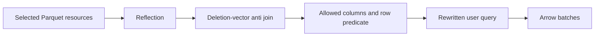

# Query engine

SuperTable reads the Parquet resources listed in current table snapshots. The read pipeline parses named SQL tables, checks access, estimates the selected files, creates engine views, and executes the rewritten SQL. The materialized public result is a Polars DataFrame; DuckDB can also return Arrow record batches.

Implementation: [executor](../supertable/engine/executor.py), [estimator](../supertable/engine/data_estimator.py), [SQL parser](../supertable/utils/sql_parser.py), [DuckDB](../supertable/engine/duckdb.py), and [Spark Thrift](../supertable/engine/spark_thrift.py). See [Data reader](10_data_reader.md) for the public API and [RBAC](11_rbac.md) for access rules.

## 1. Parse and resolve the query

`Engine` in `supertable.engine.engine_enum` has three values:

| Member | Value |
| --- | --- |
| `Engine.AUTO` | `auto` |
| `Engine.DUCKDB` | `duckdb` |
| `Engine.SPARK_SQL` | `spark_sql` |

The engine chooses where a query runs, not how it is read. Every query is parsed once, as DuckDB SQL, by the read gate (`supertable.system_query`), and that one parse is what is authorized, estimated and executed on either engine: `DataReader` hands it to `SQLParser`, and the Spark executor is sent SQLGlot's writing of it in Spark's dialect. Nothing parses the caller's text with Spark's grammar. The two grammars end a string in different places (Spark reads `\'` as a quote inside it), so a second parse could name other tables than the statement that was then run.

The read gate accepts one read statement, including SELECT queries with CTEs and set operations, and refuses:

- anything that is not a read, at the root or inside it: writes, DDL, `COPY`, `ATTACH`, `SET`, `PRAGMA`, `SELECT ... INTO`, a CTE whose body is `INSERT`/`UPDATE`/`DELETE`, and more than one statement;
- a FROM or JOIN source that is not a named table, which is every table function, such as a direct `read_parquet(...)` call;
- a `LATERAL` source other than a subquery, `VALUES`, `UNNEST` or a row generator written plainly: `range`, `generate_series`, `json_each`, `json_tree`, and Spark's `explode`, `posexplode`, `inline`, `stack`, `json_tuple` and their `_outer` forms. This is an allow-list: any other function there is refused, as is one behind a schema qualifier (`main.range(3)`) or with a quoted name;
- a scalar function that reads the engine's own state (`current_setting`, `getenv`, `getvariable`, `pg_get_viewdef`, `input_file_name`), that reads files or URLs (every name starting with `read_`, `parquet_`, `duckdb_`, `pragma_`, `http` and the other prefixes in `_FILE_READING_PREFIXES`, and the names in `_FILE_READING_FUNCTIONS`), or that calls Java (`reflect`, `java_method`, `try_reflect`), wherever it stands and however it is spelt;
- Spark's `TRANSFORM ... USING`.

Comments do not reach an engine. A comment is not part of the parse, so nothing judges its text; the gate clears comments from the statement it hands on, and `rewrite_query_with_hashed_tables`, the Spark writer and `_ensure_sql_limit` write none. A query the rewrite cannot parse, or that cannot be written for Spark, fails; it is never sent as the caller wrote it.

SQL must ultimately reference a named table: a table-free `SELECT 1` does not pass `SQLParser`.

An unqualified table name resolves inside the reader's `super_name`. `other_super.orders` resolves `orders` in `other_super`, using the same organization. A reference to a CTE is excluded from the physical table list, and it is one only where the engine reads it as one (`supertable.utils.sql_compat.is_cte_reference`): unqualified, inside the query its `WITH` is attached to, and, within that `WITH`'s own definitions, after the CTE is defined unless the `WITH` is `RECURSIVE`. Any other use of the name is a table: it is looked up in the catalog and refused when it is not there, so a CTE named like an object of the engine's own catalog (`information_schema.tables`, `duckdb_views`, a view the reader built) does not hide a read of it. One alias cannot be a CTE in one place and a table in another. The executors send on no table they did not build a view for: `rewrite_query_with_hashed_tables` raises for one that is not a CTE of the query. Repeated physical table references are merged for schema validation and resource estimation. Distinct aliases identify query views, so use explicit, distinct aliases for joins and nested references.

The parser collects source columns from projections and expressions, including predicates and join conditions. A wildcard is represented internally by an empty column list. This requests the full source schema; it does not represent an empty projection.

## 2. Read current snapshots and estimate resources

`DataEstimator(organization, storage, tables, predicate_constraints=None, plan_stats=None, fullscan=False)` reads the Redis leaf entry of each table the query names, all the tables of one SuperTable in a single round trip together with the SuperTable's root (`RedisCatalog.get_root_and_leaf_items()`; `get_leaf_items()` after a read of the root, where that one read is not to be had). A root found there is not asked for again when the lake object of each table is built (`SuperTable(..., known_to_exist=True)`). It does not list the SuperTable to find them, so the cost of this step does not grow with the number of tables in the lake or of keys in the Redis database. Two cases list every leaf of the SuperTable instead (`scan_leaf_items()`): a table named like its SuperTable, the legacy way to ask for all of its tables, and a query one of whose tables has no snapshot under its name, where the listing decides what is found and how the read fails. It uses a leaf's embedded snapshot payload when that payload contains a resource list; otherwise it reads the referenced snapshot file from storage. Resource entries supply Parquet paths and file sizes, and snapshot schemas supply known column names and types.

`estimate()` returns a `Reflection` containing:

- Storage implementation name, estimated bytes, total file count, and latest selected leaf update time.
- A `SuperSnapshot` for each selected table, including its version, files, and schema columns.
- Separate dictionaries to which the reader attaches RBAC and deletion-vector definitions.

Missing requested columns, no selected snapshots, or a selected table without Parquet files raise an execution error. An existing but resource-free table is therefore different from a populated table whose SQL predicate returns zero rows.

The estimator has an aggregation branch when a simple name equals its SuperTable name: it selects all non-internal leaves. The public reader still performs its ordinary root/leaf existence checks first; do not assume that a bare SuperTable name automatically forms a queryable union in every catalog state.

### Predicate pruning

Pruning is enabled by default through `SUPERTABLE_READ_PRUNING_ENABLED=true`. `fullscan=True` bypasses this SuperTable file-pruning step; the SQL engine still evaluates the original query and can perform its own scan optimizations.

The parser extracts direct column-to-literal comparisons (`=`, `<`, `<=`, `>`, `>=`), `BETWEEN`, and literal `IN` lists from conjunctions in SELECT `WHERE` clauses. An `IN` list becomes its minimum/maximum interval. Reversed comparisons are normalized. Numeric, boolean, string, and supported date/timestamp literals have separate comparison handling.

Unsupported expressions are left to SQL execution. For example, OR branches, functions applied to columns, column-to-column comparisons, and JOIN predicates do not supply these file constraints. An unqualified predicate is resolved only when its scope has one unambiguous source.

The pruner compares constraints with stored row-group statistics. It removes a file only when every table occurrence excludes all of that file's indexed row groups. A self-join or repeated CTE reference with an unrestricted occurrence prevents pruning for that physical table. Missing or unusable statistics retain the file. ASCII string ranges account for DuckDB's case-insensitive collation; non-ASCII values conservatively retain files. Timestamp comparisons widen bounds to account for session timezone uncertainty.

If pruning would remove every file, the implementation retains a subset covering the available schema. The SQL engine evaluates the original predicate against that subset and produces the empty result while still binding schema-dependent expressions. Statistics extraction, range handling, and this schema-covering fallback are implemented in [processing.py](../supertable/processing.py).

### Estimated bytes

With `SUPERTABLE_READ_PROJECTION_SIZING_ENABLED=true`, an explicit column projection reduces the size estimate. The estimator first uses selected columns' recorded `compressed_bytes`; when those are unavailable it approximates a proportion from schema type widths. Without projection sizing it sums complete surviving file sizes.

The estimate is a routing input, not measured peak memory or a billed byte count. It can differ from actual reads, particularly when system columns and columns needed only by row filters are added later.

Plan statistics include `REFLECTIONS`, `REFLECTION_SIZE`, and `REFLECTION_SIZE_RAW`. When pruning is enabled, they also include `FILES_BEFORE_PRUNE`, `FILES_PRUNED`, `FILES_KEPT`, `PRUNE_DURATION_MS`, and available pruning counters.

## 3. Select an engine

AUTO examines active Spark cluster registrations for the organization:

1. If none are active, it selects DuckDB.
2. Otherwise it compares the estimate with the minimum `min_bytes` among active clusters.
3. At or above that minimum it selects Spark; below it, DuckDB.

Spark's subsequent cluster selection also enforces each cluster's `max_bytes` when positive and selects randomly among eligible active clusters. AUTO's first decision does not check the maximum ranges, so it can select Spark and then fail because no cluster accepts that job size. It does not automatically retry the query on DuckDB.

Explicit `Engine.DUCKDB` bypasses routing. Explicit `Engine.SPARK_SQL` requests a cluster with `force=True` in both the materialized and the streaming executor, bypassing cluster byte ranges while still requiring an active cluster.

`engine_lite_max_bytes` and `engine_freshness_sec` are present in configuration but do not participate in `Executor._auto_pick()`. The current executor always uses the `lite` DuckDB configuration; it does not select a separate `pro` execution implementation.

## 4. DuckDB execution

DuckDB keeps a connection in thread-local state. Each query creates views over its selected Parquet files with `union_by_name=TRUE` and `HIVE_PARTITIONING=FALSE`, then runs on a cursor of that connection. A cursor sees the connection's views and what the connection's database holds, but none of the connection's session settings. The engine therefore configures object storage for the whole database when a query reads remote paths. The store's endpoint, region, URL style, TLS and credentials go into one temporary DuckDB secret, kept in memory, which every S3 read on any cursor signs with. The HTTP timeout is set globally, as the memory limit, thread count and caches already are. No setting holds a credential, so a query could not read one with `current_setting()` even where the read gate admitted that call, which it no longer does. `duckdb_secrets()` is the only SQL that shows a secret, and it redacts the secret and session token; it is a table function, which the read gate refuses in FROM, after `LATERAL` and by name.

The view chain is:

The reflection projection includes `__rowid__` and `__timestamp__` when needed for internal processing. A deletion vector removes row IDs through an anti join, and the public view normally hides both system columns. RBAC views then restrict rows and columns. Columns needed only to evaluate a row filter are available inside the filter and hidden from the resulting projection.

The reflection and the deletion-vector layer are one view per table of the query: the reflection is a subquery of the view that strips the system columns and anti-joins the vector. DuckDB resolves a view's files when the view is created and again whenever something is bound over it, opening every file each time, so a reflection that was a view of its own cost every read one more pass over all its files; the files as they are, system columns and deleted rows included, also no longer have a name in the connection's catalog. A table named twice in a query with the same columns has one view. The RBAC view is a view of its own on top. A view per layer, the reflection first, is kept in two cases: with `SUPERTABLE_DUCKDB_MATERIALIZE=table`, and for a read that has to fetch a deletion vector's parts from an object store itself (the vector is not yet cached on the connection, or the cache is off), because whether the data files had to be read through presigned URLs decides how the vector's parts are asked for.

View names are derived from the table, snapshot version, and projection, with a query-specific suffix. On handle closure the engine closes the Arrow reader and cursor, drops query views, and releases deletion-vector cache references. The shared connection remains available for later queries.

With `SUPERTABLE_DUCKDB_MATERIALIZE=table` the reflection is a table instead of a view: the rows are read into the connection when the query starts. That table is the query's own. Its name carries the query's suffix, two aliases of one table with the same columns share it, and handle closure drops it after the views that stand on it, so repeated and concurrent reads of a table neither meet an existing table nor lose one to another query's teardown.

Deletion-vector tables are cached on each reader thread's connection with a configured capacity and TTL: by default the 8 most recently used versions of each table's vector, and 300 seconds without a read. A delete adds a part to the vector and so makes a new version of it; the versions of one table are recognised by the folder its parts are written under (`<table>/tombstone/`, whichever hour folder below it), so a table that is deleted from and read keeps at most that many. Referenced cache entries are released when the stream closes, and an entry that is referenced is never dropped.

### File-access lock

The read gate is what keeps a file function out of a query. Behind it, the connection a query runs on is confined by DuckDB itself. On a connection's first query, after the engine has configured object storage for that query's paths and before it builds any view, `lock_file_access` sets `allowed_directories` and then `enable_external_access=false`. DuckDB lets neither be undone or widened while the database runs, and every cursor of the connection is bound by them. A query that got past the gate would then be refused, with a permission error, on:

- a local file outside the list: `/etc/hostname`, `/proc/self/environ`, a path that leaves a listed directory through `..` or through a symbolic link, a file read through a view created before the lock
- `COPY ... TO`, `EXPORT DATABASE` and `ATTACH` outside the list
- `LOAD` of an extension, and a change of the spill directory
- a URL of a scheme that is not on the list

The list holds local directories and URL schemes:

| Entry | On the list | Why |
| --- | --- | --- |
| The application home (`SUPERTABLE_HOME`) | always | A LOCAL lake's keys are paths relative to it, DuckDB's pinned home with its extensions is under it, and so are the default spill and cache directories |
| The connection's spill directory | always | DuckDB adds it itself; it is named besides for when it is not under the home |
| `SUPERTABLE_DUCKDB_EXTERNAL_CACHE_DIR` | on a DuckDB build with a cache directory | The external file cache |
| `SUPERTABLE_DUCKDB_FILE_ACCESS_DIRECTORIES` | when set | A LOCAL lake that is not under the home |
| `s3://`, `http://`, `https://`, `gcs://` | when `httpfs` is loaded | Every URL form a storage key is resolved to |

Every form the read path hands DuckDB falls under one entry:

| Storage | Form | Entry |
| --- | --- | --- |
| LOCAL | the key, a path relative to the working directory, which the package sets to the application home at import | application home |
| S3, MinIO | `s3://bucket/key` | `s3://` |
| S3, MinIO with `SUPERTABLE_DUCKDB_USE_HTTPFS` | `http(s)://host/bucket/key`, or `http(s)://bucket.host/key` in vhost style | `http://`, `https://` |
| S3, MinIO presigned | the same URL with `X-Amz-*` parameters | `http://`, `https://` |
| Azure | a SAS URL, `https://account.blob.core.windows.net/container/key?...`; presigning is on by default for Azure | `https://` |
| Azure with `SUPERTABLE_DUCKDB_USE_HTTPFS` | the blob URL without a signature | `https://` |
| GCS | `gcs://bucket/key` | `gcs://` |
| GCS with `SUPERTABLE_DUCKDB_USE_HTTPFS`, or presigned | `https://storage.googleapis.com/bucket/key`, with `X-Goog-*` parameters when signed | `https://` |
| any | a key that is already a URL is passed on as it is | its scheme, if listed |

The presigned forms come from `SUPERTABLE_DUCKDB_PRESIGNED` or from the retry a 301 or 403 on the first read takes. The parts of a deletion vector are resolved as data files are and fall under the same entries. `azure://container/key`, which the Azure storage returns when presigning is off, is not listed: DuckDB reads it only with its `azure` extension, which the package neither loads nor gives credentials, so that form is not readable with or without the lock.

URLs are allowed by scheme, not by bucket or host. DuckDB compares a URL prefix as text and does not resolve `..` in a URL, so `http://host/lake/../other/x` passes a `http://host/lake/` prefix and the server answers for `/other/`. A narrower entry would look like a boundary without being one, and a presigned URL of a form the list did not foresee would fail every read on the connection. Local paths are different: DuckDB resolves both the entries and each path it checks through `..` and symbolic links.

The lock is frozen when it is set, so everything a connection will need is put in place first:

- `httpfs` cannot be loaded afterwards. The engine loads it before the lock when the first query reads URLs, and also when the configured storage is an object store and the first query happens to read none. It is looked for where `LOAD` finds it, under the application home, then where DuckDB auto-loads it from, under the operating-system home, and is installed only where `SUPERTABLE_DUCKDB_ALLOW_EXTENSION_DOWNLOAD` permits.
- A connection locked without `httpfs` has no URL scheme on its list: a LOCAL deployment's read connection reaches no network. If a later query does bring a URL, the engine replaces the connection with a new one. Streams still open on the old one read to their end.
- DuckDB's secret manager is started before the lock. It starts on first use by listing `~/.duckdb/stored_secrets` under the operating-system home, which is outside the list; a first use under the lock would fail there and leave the manager unusable for the life of the process.
- `lock_configuration` is not used. The memory limit, thread count, HTTP timeout and cache switches follow the engine configuration, which is read for every query: a query sends the statement for one of them when its value is not the one already in force on the connection (it used to send all of them every time). They and the store's secret can still be set on a locked connection.

What the lock does not do:

- It is not the read gate and it is not RBAC. On a locked connection the lake's own files can still be read as they lie, without the role's column list, row filter or deletion vector, and so can any URL of a listed scheme, an internal address included. Keeping a query from saying that remains the gate's work.
- DuckDB's list does not tell reading from writing, and the spill directory has to be written. A file under a listed directory can be written, and `INSTALL` into the home's extension directory is not refused; `LOAD` is.
- It confines the read connection only. The write path's probe connection and the diagnostics connections run no caller SQL and are not locked.

If the lock cannot be set as designed, on a DuckDB older than 1.2 or one that does not keep the schemes as URL prefixes, the read fails with an error that names `SUPERTABLE_DUCKDB_FILE_ACCESS_LOCK`; it is not run unlocked. When DuckDB refuses a file on a locked connection, the engine logs a warning that names both settings.

### Configuration

Organization engine configuration is resolved from Redis first, then environment variables, then defaults. Shared fields live at the configuration root; DuckDB fields live in the `lite` or `pro` section. `resolve_engine_config_provenance()` reports each field's source.

| Environment variable | Default | Use |
| --- | --- | --- |
| `SUPERTABLE_DUCKDB_MEMORY_LIMIT` | `1GB` | DuckDB memory limit |
| `SUPERTABLE_DUCKDB_THREADS` | empty | Explicit thread count; otherwise derived from CPU, memory, and multiplier |
| `SUPERTABLE_DUCKDB_IO_MULTIPLIER` | `3` | Multiplier used by automatic thread sizing |
| `SUPERTABLE_DUCKDB_HTTP_TIMEOUT` | empty | Optional positive HTTP timeout |
| `SUPERTABLE_DUCKDB_EXTERNAL_CACHE_SIZE` | `5GB` | Enables the external file cache and requests a size cap where supported |
| `SUPERTABLE_DUCKDB_EXTERNAL_CACHE_DIR` | empty | Uses the application home's `duckdb_cache` directory where supported |
| `SUPERTABLE_DUCKDB_HTTP_METADATA_CACHE` | `true` | HTTP metadata caching |
| `SUPERTABLE_DUCKDB_PRESIGNED` | `false` | Prefer storage presigned paths during estimation |
| `SUPERTABLE_DUCKDB_USE_HTTPFS` | `false` | Use constructed HTTP URLs instead of S3 URLs when resolving object-store keys |
| `SUPERTABLE_DUCKDB_ALLOW_EXTENSION_DOWNLOAD` | `false` | Permit installing `httpfs` if it is not already available |
| `SUPERTABLE_DUCKDB_FILE_ACCESS_LOCK` | `true` | Lock the read connection's file access after its first query has loaded what it needs |
| `SUPERTABLE_DUCKDB_FILE_ACCESS_DIRECTORIES` | empty | Directories the locked connection may open beside the application home, separated by `:` |
| `SUPERTABLE_STREAM_BATCH_ROWS` | `65536` | Default Arrow batch row count |

Memory values accept positive numbers with units such as `MB`, `GB`, `MiB`, and `GiB`; a bare number is interpreted as GB. Invalid memory limits fall back to `1GB`. Thread derivation uses approximately one thread per 400 MB, capped by CPU count times the I/O multiplier.

Initialization sets the default collation to `nocase`, disables insertion-order preservation where supported, and configures a spill directory under the application home. Add `ORDER BY` when output order matters.

Remote S3, GCS and HTTP reads require DuckDB's `httpfs` extension. Missing local extensions cause a clear runtime error unless online installation is enabled. Storage paths resolve through storage URL helpers where available. Certain HTTP/authentication failures during reflection creation trigger one retry using presigned paths. The parts of a deletion vector take the same retry, whether the vector is read into its cached table or inline, and are signed without a first attempt when the query's data files already needed it; a vector that cannot be read either way fails the query, since a table read without it would bring its deleted rows back. For the retry a path is turned back into the key the storage was given when it made the path: `s3://`, `gcs://`, `gs://`, `azure://` and `az://` paths give the key after the bucket or container, `http(s)://` paths the key after the bucket in the host or the path, where the bucket is the storage's own (`STORAGE_BUCKET` only for a storage that names none). The storage's base prefix (`SUPERTABLE_PREFIX`) is then taken off, for every form: each storage writes it into the path and adds it again in `presign`. Optional DuckDB settings are applied only where supported, so a dedicated external-cache cap depends on the installed DuckDB build.

## 5. Spark execution

The Spark implementation uses PyHive to connect to a registered Thrift endpoint. Cluster configuration supplies `thrift_host`, `thrift_port` (default `10000`), `auth` (default `NONE`), and optional credentials. Missing PyHive or an eligible active cluster raises an error.

Each query opens its own Thrift session. The executor first SETs on it the S3 options the cluster registration carries (`s3_endpoint`, `s3_access_key`, `s3_secret_key`, `s3_region`, `s3_use_ssl`, `s3_path_style`), skipping any the server refuses; without them the server's launch configuration applies. It then sets `spark.sql.variable.substitute=false`. Spark otherwise expands `${...}` in SQL text from the session configuration, the server's environment and its JVM system properties, so `SELECT '${spark.hadoop.fs.s3a.secret.key}'` would return the object-store secret. That SET is not guarded: if the server refuses it, the query fails instead of running with substitution on.

The executor builds temporary Parquet views, combines multiple files with `UNION ALL`, applies deletion and RBAC views, rewrites SQL to Spark syntax, and attempts to capture `EXPLAIN EXTENDED`. S3 paths are converted to `s3a://`; optional presigning is controlled by `SUPERTABLE_SPARK_PRESIGNED`.

Both the materialized and the streaming executor ask Spark for a stream. `SparkThriftExecutor.execute()` then returns a `SparkStreamHandle`, which pulls rows with `fetchmany`, in batches of `SUPERTABLE_STREAM_BATCH_ROWS` or the `batch_rows` a stream asks for, and converts each batch to Arrow. The handle owns the query's cursor, Thrift session and temporary views, and drops and closes them once it is drained or closed. Called directly without a batch size, `execute()` fetches every row into a Polars DataFrame and tears down before it returns.

The handle fixes its Arrow schema from the result's metadata before the first batch, so a stream has a schema before any row arrives and every batch shares it. BOOLEAN, the integer types, FLOAT, DOUBLE, BINARY and TIMESTAMP keep their types, a TIMESTAMP as microseconds without a time zone; STRING, VARCHAR and CHAR are strings. Spark sends a DATE as text, which the handle parses into a date. A DECIMAL keeps the precision and scale the server reports for its column. PyHive leaves those out of the cursor description, so when the result has a DECIMAL the handle reads the result metadata again, and a DECIMAL column without them fails the read. A NULL-typed column, such as `SELECT NULL`, is an Arrow null column. Every other type is a string: Spark sends ARRAY, MAP and STRUCT values as JSON text and intervals as text such as `1 00:00:00.000000000`, where DuckDB returns nested and interval types.

`SUPERTABLE_SPARK_QUERY_TIMEOUT` (default 300 seconds) bounds a query once its session is open: the setup statements, the views, the `EXPLAIN`, the statement and the handle's read of the result metadata. `SUPERTABLE_SPARK_STATEMENT_TIMEOUT` (default 120 seconds) bounds the `EXPLAIN` and the user statement, each on its own, and each batch a stream handle fetches. A stream's rows are fetched after `execute()` returns, at the consumer's pace, so only that per-batch bound applies to them; called without a batch size, `execute()` fetches inside the query timeout. When a timeout fires, the connection's socket is shut down, which fails the call in flight at once; PyHive's socket has no timeout of its own. `SUPERTABLE_SPARK_CONNECT_TIMEOUT` (default 30 seconds) is sent as the session's `hive.server2.session.check.interval`; it does not limit the client's socket.

`cancel()` is safe to call from another thread and makes no Thrift call. PyHive's client has no lock and the server answers one connection's requests in order, so a second call would wait behind the fetch in flight while both threads read the same socket. `cancel()` shuts the socket down instead: the fetch in flight, or the next one, raises a `RuntimeError` saying the stream was interrupted, which lets the stream-job runner record a cancelled or expired job as such. The server drops the session, and its temporary views with it, when the connection closes, so closing a cancelled or timed-out handle only closes its socket.

## 6. Results and monitoring

Materialization consumes Arrow batches into a Polars DataFrame and always closes the handle. Duplicate column names gain numeric suffixes. Decimal values with scale zero are normalized toward integers, with a floating-point fallback if the exact cast fails.

`QueryPlanManager` assigns a UUID query ID and a 16-character hash derived from the query plus its metadata-path input. This hash is not a snapshot version or query-result cache key. Temporary plan paths live under the application home, and old plans for the same hash are capped at 200 during initialization.

The plan extension records timings, estimated resources, status, result shape, source, query identifiers, and available engine profile in monitoring. Queries targeting monitoring sink tables skip recursive plan logging. Failures to log monitoring are non-fatal. Materialized execution records the engine; the streaming path currently does not add that engine statistic and records completion when its handle closes.
